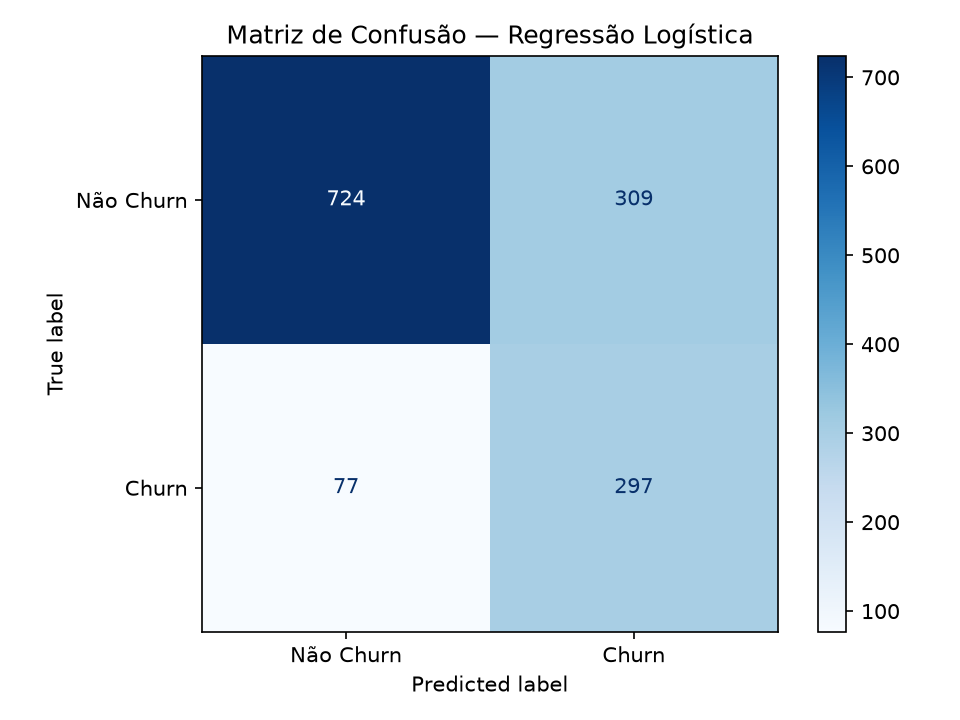
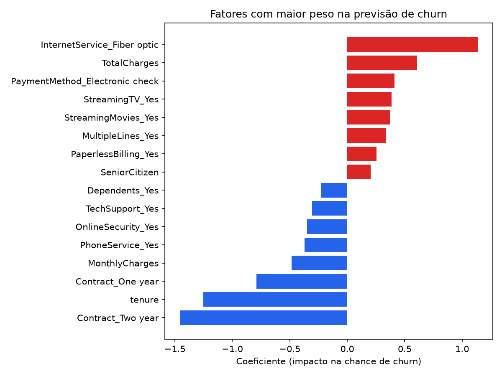

# Predição de Churn — Telco Customer Churn

Pipeline de machine learning para prever cancelamento de clientes (churn) numa operadora de telecom, com base no dataset público Telco Customer Churn (Kaggle).

## Dataset

- Fonte: [Telco Customer Churn (Kaggle)](https://www.kaggle.com/datasets/blastchar/telco-customer-churn)
- 7.043 clientes, 21 variáveis (demográficas, serviços contratados, cobrança)
- Taxa de churn: 26,58% (dataset moderadamente desbalanceado)

## Stack

Python, Pandas, scikit-learn, XGBoost, Matplotlib

## Pipeline

**Etapa 1 — EDA e Tratamento** (`eda.py`)
Tratamento da coluna `TotalCharges` (11 registros com valor ausente), análise de distribuição do churn e correlação com variáveis numéricas e categóricas.

**Etapa 2 — Feature Engineering** (`feature_engineering.py`)
One-hot encoding das variáveis categóricas, split treino/teste estratificado (80/20) e normalização das variáveis numéricas (fit apenas no treino, evitando vazamento de dado).

**Etapa 3 — Modelagem** (`modelagem.py`)
Comparação via validação cruzada (5 folds, ROC-AUC) entre Regressão Logística, Random Forest e XGBoost, todos com tratamento de desbalanceamento (`class_weight`/`scale_pos_weight`).

**Etapa 4 — Avaliação e Interpretação** (`avaliacao.py`)
Matriz de confusão, relatório de classificação e AUC-ROC no conjunto de teste; análise dos coeficientes do modelo vencedor para identificar os principais fatores de risco e proteção.

## Resultados

| Modelo | ROC-AUC (validação cruzada) |
|---|---|
| **Regressão Logística** | **0,8456** |
| Random Forest | 0,8257 |
| XGBoost | 0,8228 |

No conjunto de teste, a Regressão Logística obteve **AUC-ROC de 0,8353** e **recall de 79%** para a classe Churn — priorizando identificar clientes em risco, mesmo com queda de precisão (49%), decisão adequada pro caso de negócio (custo de perder um cliente > custo de uma retenção desnecessária).



### Principais fatores

**Aumentam o risco de churn:** internet por fibra ótica, valor total pago (TotalCharges), pagamento por boleto eletrônico, serviços de streaming.

**Reduzem o risco de churn:** contrato de 2 anos, tempo de casa (tenure), suporte técnico contratado.



## Como rodar

```bash
pip install -r requirements.txt
python eda.py
python feature_engineering.py
python modelagem.py
python avaliacao.py
```